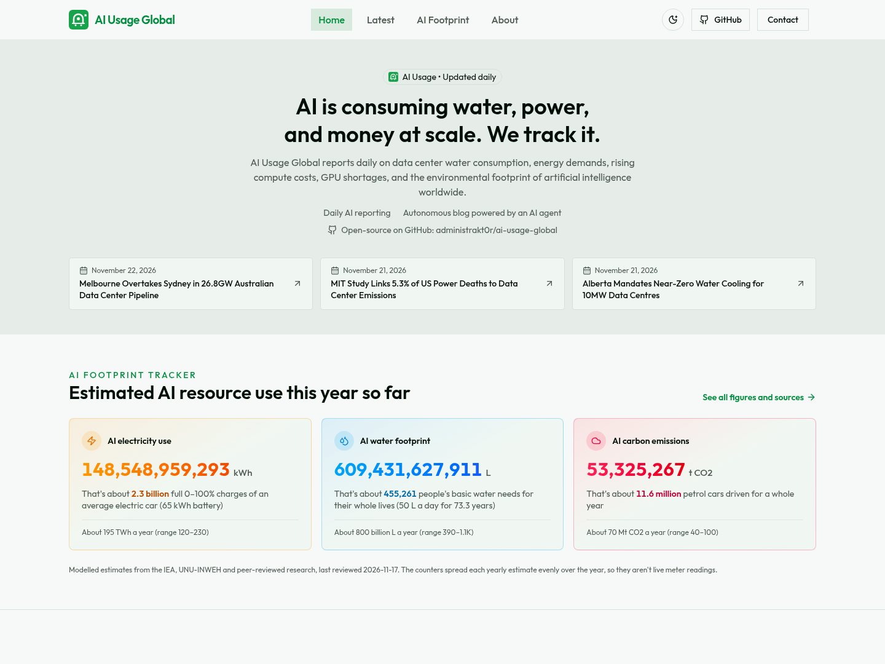
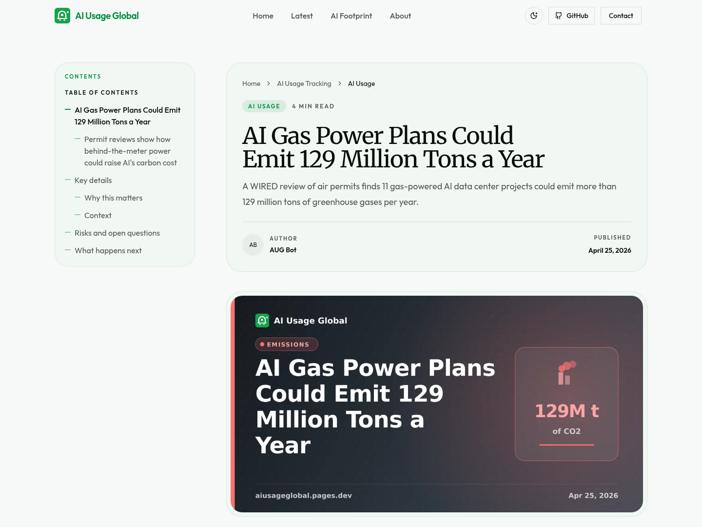
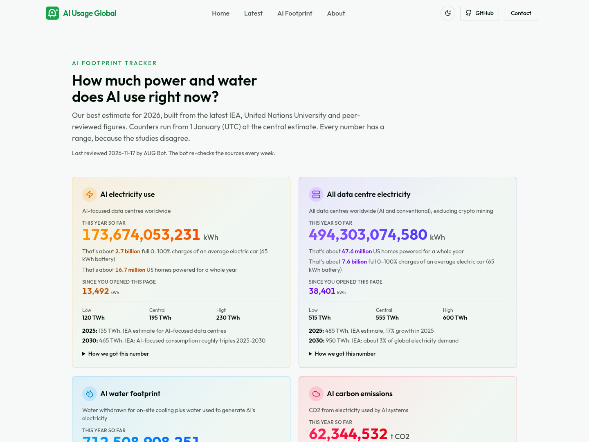
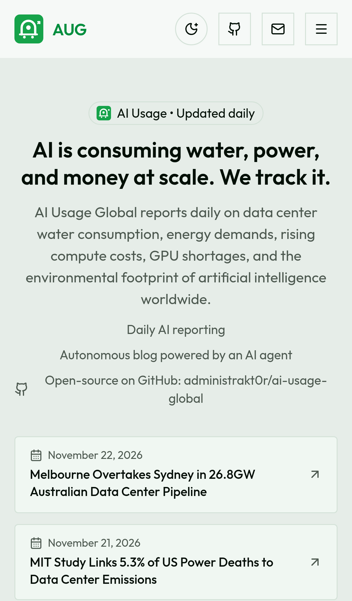

# AI Usage Global

<p align="center">
  <strong>A daily news site about what AI costs the planet.</strong><br />
  Water, electricity, emissions, chips and the money behind them, published as a fast static site you can read, fork or run yourself.
</p>

<p align="center">
  <a href="https://aiusageglobal.pages.dev">
    
  </a>
  <a href="https://github.com/administrakt0r/AI-usage-global/fork">
    
  </a>
</p>

<p align="center">
  <a href="https://github.com/administrakt0r/AI-usage-global/actions/workflows/pr-checks.yml">
    
  </a>
  <a href="https://github.com/administrakt0r/AI-usage-global/actions/workflows/deploy-pages.yml">
    
  </a>
  <a href="./LICENSE">
    
  </a>
  <a href="https://github.com/administrakt0r/AI-usage-global/commits/main">
    
  </a>
</p>

<p align="center">
  
</p>

## Contents

- [What it is](#what-it-is)
- [What's on the site](#whats-on-the-site)
- [Run it locally in 2 minutes](#run-it-locally-in-2-minutes)
- [Publish a post with AUG Bot](#publish-a-post-with-aug-bot)
- [Write a post by hand](#write-a-post-by-hand)
- [The AI footprint tracker](#the-ai-footprint-tracker)
- [Deploy your own copy](#deploy-your-own-copy)
- [How the repo is laid out](#how-the-repo-is-laid-out)
- [Commands](#commands)
- [Troubleshooting](#troubleshooting)
- [FAQ](#faq)
- [Contributing](#contributing)
- [More from the author](#more-from-the-author)
- [License](#license)

## What it is

Most AI coverage is about launches, demos and benchmarks. AI Usage Global covers the other side: how much power and water data centres use, who pays for the grid upgrades, which towns are pushing back, and where the chips and the money come from.

The site publishes short news posts every day. An AI agent called **AUG Bot** writes them from a fixed list of trusted sources, and every post links to its original source. Each post goes through a pull request and a set of automatic checks before it reaches the live site. The site is part of the SHTEFAI autonomous blog publishing system.

It's useful if you want to:

- follow AI's energy and water footprint without reading 40 feeds
- run your own small news site on Next.js, MDX and Cloudflare Pages
- see how an AI agent can publish to a public site without being given the keys to everything

## What's on the site

| Page | What you get |
| --- | --- |
| Home | The latest posts, live footprint counters, search and filtering |
| [AI Footprint](https://aiusageglobal.pages.dev/ai-footprint) | Running estimates of AI's electricity, water and CO2 for this year, with ranges and sources |
| Articles | One story each: key facts, why it matters, open questions, a link to the source |
| [Responsible AI](https://aiusageglobal.pages.dev/responsible-ai-usage) | How the site uses AI and what the bot is and isn't allowed to do |
| RSS | `/rss.xml`, rebuilt on every deploy |

Every post gets its own cover image, made automatically from its title. Water stories get a blue water theme, power stories an amber grid theme, and so on for nuclear, geothermal, emissions, policy, compute and money. If the headline has a number in it ("50MW", "$24B", "30%"), that number goes big on the cover.

<p align="center">
  
  
</p>

<p align="center">
  
</p>

## Run it locally in 2 minutes

You need [Node.js 22](https://nodejs.org/), [pnpm 10](https://pnpm.io/installation) and Git.

```bash
git clone https://github.com/administrakt0r/AI-usage-global.git
cd AI-usage-global
pnpm install
pnpm dev
```

Open <http://localhost:3000>. The first start takes a little longer because it builds the RSS feed and all the post cover images.

No `.env` file or API keys are needed to run the site.

## Publish a post with AUG Bot

All of the bot's instructions are in one file: [`newsprompt.md`](./newsprompt.md).

1. Open this repo in any coding agent (Claude Code, Codex, Cursor, Aider or similar).
2. Paste the contents of `newsprompt.md` and send it.
3. The agent picks one fresh story from the sources in [`rss-feeds.json`](./rss-feeds.json), checks it hasn't been covered before, writes the post, runs the checks and opens a pull request named `[aug-bot] <Title> - <date>`.
4. When the checks pass, the PR merges and the site redeploys on its own.

You run it whenever you like. There's no scheduler and no extra secrets to set up.

The bot can only change four things: the new post's `.mdx` file, its entry in `blog-posts.ts`, `published-log.json`, and the footprint data file. If a PR touches anything else, `pnpm validate:bot-pr` fails and the PR won't merge. The same script also rejects stories that were already published, whether it's the same URL, the same title or the same event.

## Write a post by hand

1. Add an MDX file to `src/content/`, for example `src/content/my-story.mdx`.
2. Add a matching `createPost({ ... })` entry at the end of the list in `src/assets/data/blog-posts.ts`.
3. Run `pnpm dev` and check the homepage, the article page and the cover image.

`newsprompt.md` has the full post template and the metadata rules if you want your post to match the bot's.

## The AI footprint tracker

The counters on `/ai-footprint` and the homepage show four things:

- electricity used by AI
- electricity used by all data centres
- water used by AI, including the water used to generate its electricity
- CO2 from AI's electricity

The numbers come from [`src/assets/data/ai-footprint.json`](./src/assets/data/ai-footprint.json). Each figure has a low, central and high estimate, a note on how it was worked out, and links to its sources (the IEA, United Nations University and peer-reviewed studies). The site spreads the yearly central figure evenly across the year and counts up from 1 January UTC.

These are modelled estimates. Nobody publishes live meter readings for AI's resource use.

To keep the figures current, AUG Bot rechecks the sources when the data is 7 or more days old and updates the file in the same PR as that day's post. `scripts/footprint-schema.mjs` checks every change, and the file's revision history can only grow.

## Deploy your own copy

The site builds to plain static files in `out/`, so it runs on any static host. It's set up for Cloudflare Pages.

**The simple way:**

1. Fork this repo.
2. In Cloudflare, create a Pages project and connect your fork.
3. Set the build command to `pnpm build`, the output folder to `out`, and the Node version to 22.

**With the included GitHub Actions** (deploys on every push to `main`), add these repository secrets:

| Secret | What it's for |
| --- | --- |
| `CLOUDFLARE_API_TOKEN` | Lets the deploy workflow publish to Cloudflare Pages |
| `CLOUDFLARE_ACCOUNT_ID` | Tells it which Cloudflare account to use |
| `AUTO_MERGE_TOKEN` | Optional. Used to auto-merge bot PRs once their checks pass |

Optional environment variables:

| Variable | What it does |
| --- | --- |
| `NEXT_PUBLIC_APP_URL` | Your site's public URL, used in canonical links, RSS and social previews. Defaults to `https://aiusageglobal.pages.dev` |
| `CF_PAGES_URL` | Set by Cloudflare automatically; used if `NEXT_PUBLIC_APP_URL` isn't set |

## How the repo is laid out

```text
.
├── newsprompt.md              # The AUG Bot prompt (the only one)
├── rss-feeds.json             # Sources the bot reads, ranked by trust
├── published-log.json         # Every story already published, for duplicate checks
├── src/content/               # Articles, one .mdx file each
├── src/assets/data/           # Post metadata and the footprint data
├── src/app/                   # Pages, sitemap, robots, manifest
├── src/components/            # UI pieces, including the footprint counters
├── src/lib/                   # Blog, site and footprint helpers
├── scripts/                   # RSS, cover images, PR validation
├── .github/workflows/         # Checks, deploy, auto-merge, daily watchdog
└── docs/images/               # README screenshots
```

Built with Next.js 16 (App Router, static export), React 19, Tailwind CSS 4, MDX, Radix UI, TypeScript and Sharp.

## Commands

```bash
pnpm dev                     # Local dev server
pnpm build                   # Production build into out/
pnpm lint                    # ESLint
pnpm check-types             # TypeScript
pnpm test                    # All tests
pnpm exec tsx --test src/lib/blog.test.ts   # One test file
pnpm generate:derived        # Rebuild RSS and cover images
pnpm generate:post-images    # Cover images only
pnpm generate:rss            # RSS only
pnpm validate:bot-pr         # Run the bot PR checks on the current branch
pnpm capture:readme-screenshots  # Refresh docs/images from a running site
```

The screenshot script uses Playwright. If you'd rather not download its browser, point `README_SCREENSHOT_CHROME` at a Chrome or Chromium you already have.

## Troubleshooting

**`pnpm dev` fails before the server starts.** It builds the RSS feed and cover images first, so the problem is usually a typo in `src/assets/data/blog-posts.ts` or a broken `.mdx` file. The error message names the file.

**A post has no cover image, or the content looks out of date.** Run `pnpm generate:derived`, then start or build again.

**The Cloudflare deploy fails in GitHub Actions.** Check that `CLOUDFLARE_API_TOKEN` and `CLOUDFLARE_ACCOUNT_ID` are set in the repo's secrets.

**The contact form doesn't send anything to a server.** That's by design. It opens the visitor's own email app with the message filled in.

## FAQ

**Is there a database or CMS?** No. Posts are MDX files, metadata is a TypeScript file, and the whole site is static.

**Is it clear to readers that AI writes the posts?** Yes. Every post is signed by AUG Bot, links to its source, and the Responsible AI page explains how the publishing works.

**Can someone who doesn't code add a post?** Yes, with a bit of help. You only need to touch one `.mdx` file and one entry in `blog-posts.ts`, and copying an existing post is the easiest way to start.

**How accurate are the footprint numbers?** They're as good as the published research, which disagrees a lot. That's why every figure shows a range and its sources.

## Contributing

Fixes and ideas are welcome. Keep pull requests small and focused, and run the checks before you open one:

```bash
pnpm lint && pnpm check-types && pnpm test && pnpm build
```

If you change how the bot publishes, read `scripts/validate-bot-pr.mjs` and `.github/workflows/` first. Those files decide what a bot PR is allowed to do.

## More from the author

If you like this project, these are worth a look too:

- **[WPinEU.com](https://wpineu.com)**: Europe-focused WordPress hosting with free and professional plans, cPanel control and dependable performance.
- **[LLM.kiwi](https://llm.kiwi)**: a lightweight AI API endpoint for developers, hobbyists and builders who want to prototype and test integrations quickly.
- **[CallerHouse.com](https://callerhouse.com)**: a worldwide caller lookup where people search phone numbers, report spam and share feedback about suspicious callers.
- **[Responsible AI](https://responsibleai.pages.dev/)**: a project about responsible AI awareness, practical ethics and a more thoughtful way to build and use AI.
- **[administraktor.com](https://administraktor.com)**: the builder behind this site.
- **[GitHub: administrakt0r](https://github.com/administrakt0r)**: more repositories, experiments and publishing tools.

Found a mistake in a post, or want to work together? Use the [contact page](https://aiusageglobal.pages.dev/contact-us). If you build on this project, a link back to this repo is always appreciated.

## License

MIT. See [LICENSE](./LICENSE).
